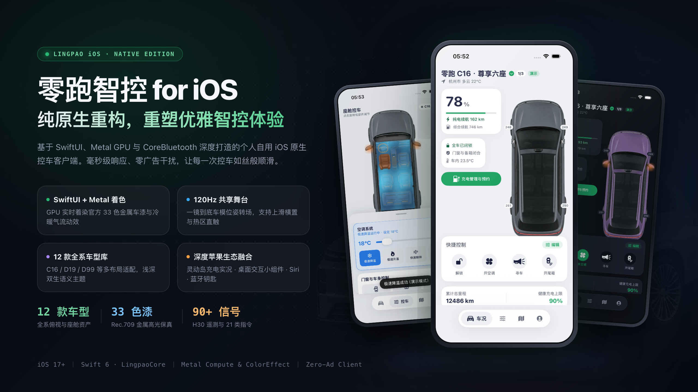
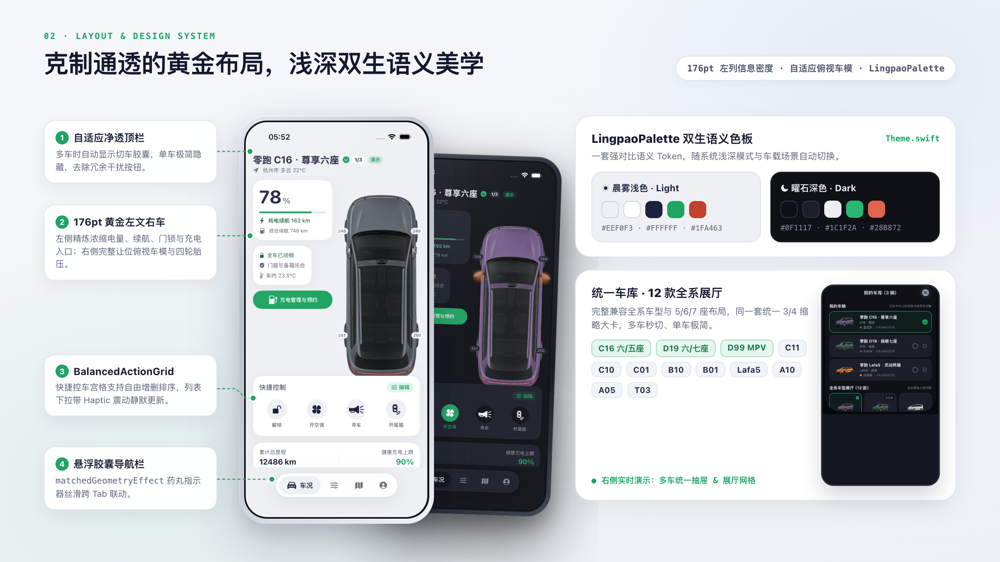
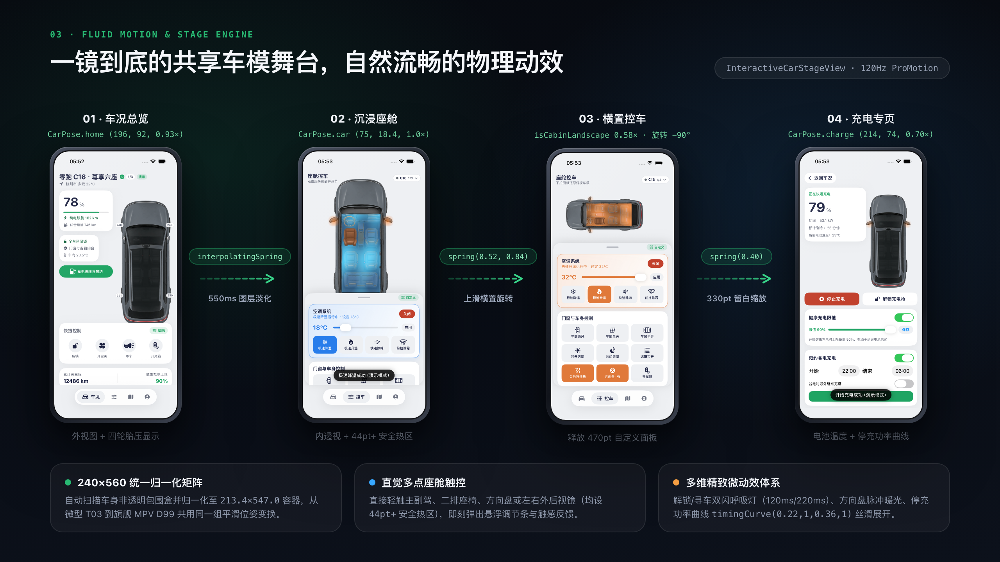
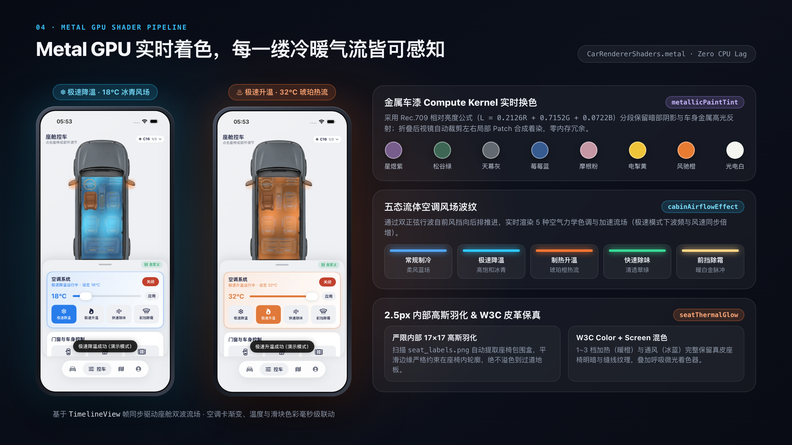
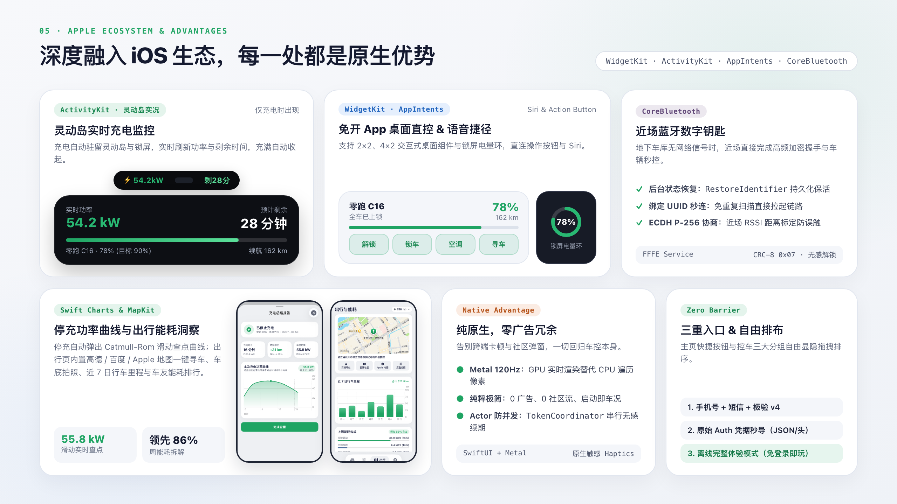
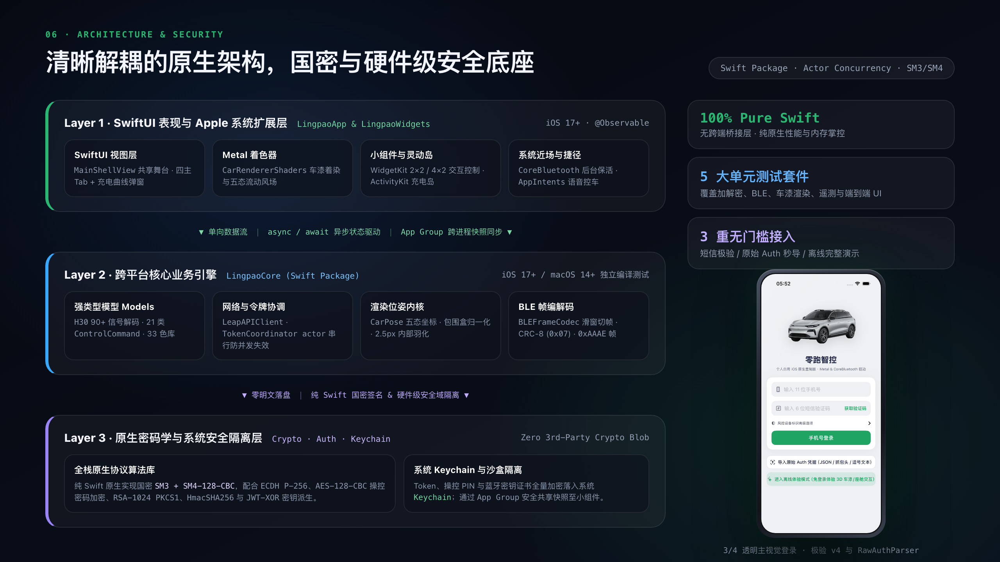

<div align="center">

# 零跑智控 iOS 原生版（Lingpao）

**纯 Swift + SwiftUI + Metal GPU + CoreBluetooth 原生重构的零跑汽车 iOS 客户端**


<br/>



</div>

---

> ### 🙏 特别致谢
>
> 本项目深受 Android 端优秀第三方车控应用 **「零三方」** 的启发，由衷感谢原作者 **小红书 `@nomad`**！  
> 感谢 `@nomad` 在产品交互设计、共享车模座舱可视化、Rec.709 金属车漆着染、全系车型高精度资产体系以及通信协议研究上的卓越设计与无私分享。正是基于「零三方」确立的优雅产品体验标杆，本仓库得以采用 **SwiftUI + Metal + CoreBluetooth** 完成面向 iOS 生态的纯原生开源实现。

---

## ✨ 视觉与核心特性

### 1. 克制通透的黄金布局 · 浅深双生语义美学
- **176pt 左文右车布局**：左侧精炼浓缩 SOC 电量、纯电/综合续航、门锁状态与充电专页入口；右侧完整让位给正交俯视车模与四轮胎压安全徽章，互不遮挡。
- **自适应顶栏与悬浮胶囊导航**：多车自动显现切车胶囊，单车极简隐藏；底部胶囊导航基于 `matchedGeometryEffect` 实现丝滑药丸切换。
- **浅深双生设计系统 (`LingpaoPalette`)**：完整适配晨雾浅色（Light）与曜石深色（Dark）语义色板，并内置 12 款全系车型统一 3/4 缩略展厅。



---

### 2. 一镜到底的共享车模舞台 · 120Hz 物理动效
- **`InteractiveCarStageView` 共享舞台**：围绕 `CarPose` 五态位姿坐标与 `240×560` 归一化包围盒矩阵，在「车况 → 座舱 → 充电 → 出行 → 我的」之间以 `interpolatingSpring` + `550ms` 内外图层交叉淡化丝滑演进。
- **上滑控车坞横置转场**：控车面板上滑展开时，顶部车模同步缩小至 `0.58×` 并向左横旋转 `-90°` 悬停，优雅释放 `470pt` 自定义控车面板。
- **直觉多点座舱触控**：主副驾/后排座椅、方向盘与左右外后视镜均具备 `44pt+` 安全触控热区，轻触即弹出浮动调节条并伴随触感反馈。



---

### 3. Metal GPU 实时着色 · 33 色车漆与五态冷暖风场
- **金属漆 Compute Kernel (`metallicPaintTint`)**：基于 Rec.709 相对亮度公式分段保留车身阴影与金属高光反射，实时着染 **33 种官方车漆**；折叠后视镜自动裁剪局部 Patch 合成着染。
- **五态流体空调波纹 (`cabinAirflowEffect`)**：借助 `TimelineView` 帧同步驱动双正弦行波自前风挡向后排推进，直观区分常规制冷、极速降温、制热升温、快速除味与前挡除霜。
- **2.5px 内部高斯羽化 & W3C 皮革保真 (`seatThermalGlow`)**：扫描 `seat_labels.png` 精准提取座椅外接热区，边缘羽化严格约束在座椅内轮廓，加热（暖橙）与通风（冰蓝）完整保留真皮纹理明暗。



---

### 4. 深度融入 Apple 原生生态 · 零广告纯享体验
- **灵动岛与锁屏实况 (`ActivityKit`)**：仅在充电进行时常驻灵动岛与锁屏横幅，实时刷新功率、进度与预计剩余时间，充满自动收起。
- **桌面交互小组件与 Siri (`WidgetKit` + `AppIntents`)**：提供 2×2 紧凑车况、4×2 桌面控车面板与锁屏电量环，免打开 App 即可触发解锁、锁车、空调、寻车，原生支持 Siri 与 iPhone Action Button。
- **近场蓝牙数字钥匙 (`CoreBluetooth`)**：支持后台状态恢复（`RestoreIdentifier`）、已绑定 UUID 快速检索重连、`ECDH P-256` 协商与 RSSI 近场标定，地下车库弱网秒控。
- **图表与导航洞察 (`Swift Charts` + `MapKit`)**：停充自动弹出 Catmull-Rom 滑动查点功率曲线；出行页内置高德/百度/Apple 地图寻车、底盘留存图、近 7 日行车里程与周能耗排行。



---

### 5. 解耦架构与原生安全底座
- **跨平台核心引擎 (`LingpaoCore`)**：纯 Swift Package（支持 iOS 17+ / macOS 14+ 独立编译测试），涵盖 `H30` 90+ 车况信号强类型解码、21 类远程指令构建、`TokenCoordinator actor` 并发串行双 Token 无感续期与 `BLEFrameCodec` 滑窗帧编解码。
- **全栈原生密码学**：纯 Swift 原生实现国密 `SM3` + `SM4-128-CBC`、`ECDH P-256`、`AES-128-CBC`、`RSA-1024 PKCS1`、`HmacSHA256` 与 `JWT-XOR` 密钥派生，零第三方黑盒安全库。
- **系统级隐私隔离**：账号 Token、4 位操控 PIN 与 BLE 证书加密存储于系统 `Keychain`，通过 `App Group` 安全沙盒向 Widget 与灵动岛同步脱敏快照。



---

## 🚘 支持全系车型（12 款 + 33 色官漆）

| 车型 | 车身形态 | 支持座椅布局 | 核心特性适配 |
| :--- | :--- | :--- | :--- |
| **C16** | SUV | `6 座 (2+2+2)` / `5 座 (2+3)` | 专属 `CarPose`、主驾通风/加热独立贴图、方向盘/灯光/折镜全 FX |
| **D19** | 旗舰 SUV | `6 座 (2+2+2)` / `7 座 (2+3+2)` | 独立双套座舱底图与 `seat_labels_7` 多排热区映射 |
| **D99** | 旗舰 MPV | `7 座 (2+2+3)` | 电动左右侧滑门控制、二排独立通道识别 |
| **C11 / C10 / B10 / A10** | SUV | `5 座 (2+3)` | 后排连通长椅智能分区、官方专属金属漆 |
| **C01 / B01** | 轿车 | `5 座 (2+3)` | 轿车前俯视比例归一化、金属车漆高光保真 |
| **Lafa5 (`B05`) / A05** | 两厢掀背 | `5 座 (2+3)` | `B05` 自动别名识别、电掣黄/风驰橙等潮流色系 |
| **T03** | 精品微车 | `4 座 (2+2)` | 轻量车身包围盒自适应、经典四座布局 |

---

## 🗂 工程结构

```text
lingpaozhikong-ios/
├── Lingpao.xcodeproj                # Xcode 主工程（含 App / Widgets / UITests 三大 Target）
├── LingpaoCore/                     # 跨平台 Swift Package（iOS 17+ / macOS 14+）
│   ├── Sources/LingpaoCore/
│   │   ├── Auth/                    # RawAuthParser（JSON/抓包头/文本解析）& 极验 v4 模板
│   │   ├── BLE/                     # ECDH P-256 协商、CRC-8 (0x07)、0xAAAE 帧滑窗编解码
│   │   ├── Crypto/                  # SM3 / SM4-128-CBC / RSA / AES / HmacSHA256 / JWT-XOR
│   │   ├── Models/                  # H30 90+ 信号解码、21 类 ControlCommand、12 车 33 色库
│   │   ├── Network/                 # TokenCoordinator actor 与全量云端 API 客户端
│   │   └── Renderer/                # CarPose 五态位姿、CarPaintEngine、2.5px 内部羽化与离线数据
│   └── Tests/LingpaoCoreTests/      # 5 大核心 XCTest 单元测试套件
├── LingpaoApp/                      # SwiftUI 主应用层
│   ├── App/                         # AppViewModel (@Observable)、Theme 语义色板
│   ├── Auth/                        # WKWebView 极验 v4 验证弹窗、数美接口适配层
│   ├── BLE/                         # CoreBluetooth 蓝牙数字钥匙（支持后台恢复与 RSSI 标定）
│   ├── CarRenderer/                 # CarAssetLoader（32 槽缩略图缓存）与 InteractiveCarStageView
│   ├── Features/                    # 登录、车况首页、座舱控车、充电专页、出行图表、设置与车库
│   ├── Intents/                     # Siri 语音、快捷指令与 Action Button AppIntents
│   ├── Shaders/                     # CarRendererShaders.metal GPU 着色器源码
│   ├── Storage/                     # KeychainStore 安全存储封装
│   └── Resources/Assets/car/        # 12 款全系车型俯视/座舱/3-4 主视觉/蒙版与 FX 贴图资产
├── LingpaoWidgets/                  # WidgetKit 桌面/锁屏小组件与 ActivityKit 充电灵动岛
├── LingpaoAppUITests/               # 端到端 UI 自动化测试与全场景回归
├── Scripts/generate_xcodeproj.py    # 零依赖 Python 自动生成 Xcode 工程文件脚本
└── promo/                           # 项目高清宣传套图
```

---

## 🚀 快速开始与真机运行

### 环境要求
- macOS 14.0+ / Xcode 16.0+（若编译 `.metal` 着色器时提示缺少工具链，请执行 `xcodebuild -downloadComponent MetalToolchain`）
- 目标系统：iOS 17.0+

### 1. 克隆并打开工程

```bash
git clone https://github.com/nnkk000023/lingpaozhikong-ios.git
cd lingpaozhikong-ios
open Lingpao.xcodeproj
```

### 2. 配置个人签名（真机调试）
1. 在 Xcode 中分别选中 **`LingpaoApp`** 与 **`LingpaoWidgets`** 两个 Target。
2. 在 **Signing & Capabilities** 中选择你的个人 Apple ID Team。
3. 将两者的 Bundle Identifier 保持一致的父子前缀（例如主 App 设为 `com.<yourname>.lingpao`，Widget 设为 `com.<yourname>.lingpao.widgets`）。
4. 若修改了 App Group 标识符，请同步核对 `Lingpao.entitlements`、`LingpaoWidgets.entitlements` 与 `KeychainStore.swift` 中的 `group.com.lingpao.personal`。

### 3. 三种登录与体验方式
- **离线体验模式（最推荐初上手）**：登录页直接点击「进入离线体验模式」，免账号即可体验全部 12 款车型切换、Metal 实时车漆换色、座舱座椅点击调节热区、流体空调波纹、横置控制坞与充电功率曲线。
- **导入原始 Auth 凭据**：点击「导入原始 Auth 凭据」，支持粘贴抓包 JSON、HTTP Header 片段或 `accountId,token,refreshToken`，跳过风控直接换取本地会话并后台自动续期。
- **手机号 + 验证码 + 极验 v4**：如需完整 iOS 端短信登录闭环，可在 Xcode 中引入对应 `SmAntiFraud.xcframework`（`ShumeiDeviceProvider.swift` 已预留 `#if canImport(SmAntiFraud)` 编译接入点），或在登录页「风控设备标识高级选项」中填入已有 `smDeviceId`。

### 4. 运行核心测试与工程刷新

```bash
# 运行跨平台核心单元测试（加解密 / BLE 协议 / 车漆引擎 / 遥测解码）
cd LingpaoCore && swift test

# 若后续增删 Swift 源文件，可一键重建 .xcodeproj
DEVELOPER_DIR=/Library/Developer/CommandLineTools python3 Scripts/generate_xcodeproj.py
```

---

## ⚠️ 声明与开源协议

- **非官方项目声明**：本项目为个人学习 **SwiftUI、Metal Shader、CoreBluetooth、WidgetKit 与 ActivityKit** 的开源技术重构作品，与零跑汽车官方无任何关联。
- **隐私与数据安全**：所有网络请求均由本地设备直连官方云端网关，无任何第三方中转服务器；所有敏感凭据（Token、操控 PIN、蓝牙钥匙证书）仅安全存储于设备本地系统 `Keychain` 中。
- **致谢重申**：再次衷心感谢「零三方」作者 **小红书 `@nomad`** 对本项目灵感、交互设计理念及车辆视觉体系的贡献！
- **开源协议**：本项目基于 [MIT License](./LICENSE) 开源。
